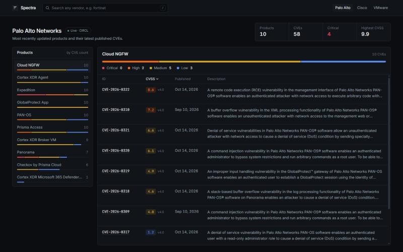
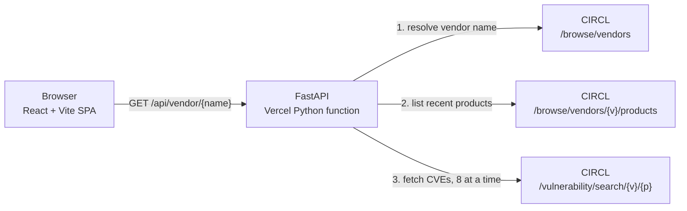

# Spectra

Spectra is a dashboard for looking up a vendor's latest published CVEs, grouped by product. It runs on live data from CIRCL's [Vulnerability-Lookup](https://vulnerability.circl.lu) service.

**[Live demo](https://spectra-frontend-theta.vercel.app)** · **[API docs](https://cve-backend.vercel.app/docs)** · **[Roadmap](docs/PLAN.md)**



## Why I built this

I wanted to build an app that showcases the vulnerabilities in products from the biggest vendors, and I found it really interesting to break down how severe they actually are. I also wanted to practice my development skills and learn some new technologies.

## What it does

- **Look up any vendor.** Type a name (`fortinet`, `cisco`, `vmware`) or pick a preset. Spectra matches it to the vendor's official name in CIRCL, so `palo alto` becomes *Palo Alto Networks*.
- **See the products with recent CVEs first.** It checks the vendor's most recently updated products and shows those with the most CVEs, each with a severity bar.
- **Read a product's CVEs.** Each CVE shows its CVSS score and version, publish date and description. The table sorts by score or date, and descriptions expand in place. Every CVE ID links to its full record on CIRCL.
- **Get the summary at a glance.** The page shows the number of products and CVEs, how many are critical, and the highest CVSS score.
- **Use it from the keyboard.** `/` focuses search, the arrow keys move through the product list, and the table headers support screen readers.

## How it works



A lookup goes through four steps:

1. **Resolve the vendor.** CIRCL keeps stale duplicate vendor entries, such as `palo alto` next to `palo alto networks`. The resolver prefers an exact or whole-word match and picks the most recently updated entry.
2. **List products.** It takes the vendor's 15 most recently updated products.
3. **Fetch CVEs in parallel.** It requests each product's CVEs concurrently, 8 at a time, with an 8-second timeout per request.
4. **Normalize the records.** CVE JSON 5 records are inconsistent, so the backend cleans them up:
   - It reads the score from the CNA's metrics, falling back to ADP metrics. It prefers CVSS 3.1, then 3.0, 4.0 and 2.0.
   - It drops records for other vendors, which CIRCL's product search sometimes returns.
   - It names products using the record's own `affected[].product` value.

Results are cached in memory for 10 minutes.

## Engineering notes

- **Vendor resolution is generic.** No vendor needs special-case code: any vendor CIRCL knows about works.
- **CORS is configured from the environment.** Exact origins come from `ALLOWED_ORIGINS`. Vercel preview URLs can be allowed through `ALLOWED_ORIGIN_REGEX`, which should be anchored on the team slug, because anyone can claim a `spectra-*.vercel.app` name. An invalid regex stops the app at startup instead of silently allowing nothing.
- **Production builds fail loudly.** If `VITE_API_URL` isn't set, the app shows a clear "no API URL" error instead of quietly calling `localhost`.
- **Theming uses design tokens.** Colors for surfaces, text and severity live in Tailwind v4's `@theme`, and components use them as utilities, never raw hex values.
- **Accessibility is built in:**
  - the search form has a real label and `role="search"`;
  - preset buttons use `aria-pressed`;
  - the product list supports arrow-key navigation;
  - sortable table headers use `aria-sort`;
  - the loading skeleton announces itself with `aria-busy`.

## Known limitations

These are known gaps, and each one is scheduled in the [roadmap](docs/PLAN.md):

| Limitation | Planned fix |
|---|---|
| The cache lives in each serverless instance, so a cold instance refetches from CIRCL. | A shared Redis cache with request coalescing (PR 3) |
| If CIRCL fails, the API returns bundled sample data with HTTP 200. The UI labels it "Sample data". | Real status codes (404, 502), and the last good result shown with a "stale" flag (PR 1) |
| CVEs are ranked by CVSS severity only. | Priority from CISA KEV and FIRST EPSS exploitation data (PR 4) |
| There are no URL routes, so views can't be bookmarked or shared. | React Router deep links and a CVE detail drawer (PRs 2 and 5) |
| Each product shows at most 10 CVEs. | Pagination (PR 3) |

## Roadmap

[`docs/PLAN.md`](docs/PLAN.md) is the full upgrade plan, split into small PRs. Each one can be merged and deployed on its own, and each design decision lists the alternatives considered.

- [ ] **0. Tooling:** linting, formatting, starter tests, GitHub Actions CI (in progress)
- [ ] **1. Backend foundation:** modular FastAPI app, async HTTP, Pydantic models, honest errors, structured logging
- [ ] **2. Frontend foundation:** React Router, TanStack Query, generated API types, app shell, light/dark themes
- [ ] **3. Data layer:** Postgres (Neon), Redis (Upstash), stale-if-error caching, rate limits
- [ ] **4. Risk prioritization:** CISA KEV and FIRST EPSS enrichment, P1–P4 priority, filters, CSV export
- [ ] **5. CVE inspector:** detail drawer, CVSS vector breakdown, 30-day EPSS sparkline
- [ ] **6. AI explainer:** plain-English CVE summaries and remediation steps from Claude, cached once per CVE
- [ ] **7. Overview and watchlist:** recent KEV additions, vendor leaderboard, shareable watchlists
- [ ] **8. Showcase polish:** Playwright and accessibility tests, security headers, analytics

## Tech stack

| Layer | Tools |
|---|---|
| Frontend | React 19, TypeScript, Vite 8, Tailwind CSS v4, self-hosted Inter and JetBrains Mono |
| Backend | Python, FastAPI, Uvicorn, Requests |
| Data | CIRCL Vulnerability-Lookup API (CVE JSON 5 records) |
| Hosting | Vercel: a static frontend plus a Python serverless function, both deployed from `main` |

## Running locally

You need Python 3.10 or newer and Node.js 22 or newer.

**Backend** (http://localhost:8000; interactive docs at `/docs`):

```bash
cd cve-backend
python -m venv .venv
source .venv/bin/activate        # Windows: .venv\Scripts\activate
pip install -r requirements.txt
python main.py
```

> On Windows, if `python` opens the Microsoft Store, use `py -m venv .venv`. Then run the app with `.venv\Scripts\python.exe main.py`.

**Frontend** (http://localhost:5173):

```bash
cd cve-frontend
npm install
npm run dev        # dev server; calls the backend at http://localhost:8000
npm run build      # type-checks, then builds for production
npm run lint
```

### Environment variables

| Variable | Used by | Purpose |
|---|---|---|
| `ALLOWED_ORIGINS` | backend | Comma-separated frontend origins allowed by CORS. `http://localhost:5173` is always allowed. |
| `ALLOWED_ORIGIN_REGEX` | backend | Optional regex for Vercel preview URLs. Anchor it on your team slug. |
| `VITE_API_URL` | frontend, at build time | The backend's base URL. Required for production builds. |

## API

`GET /api/vendor/{vendor_name}` returns the vendor's top products and their latest CVEs:

```json
{
  "status": "success",
  "vendor_label": "palo alto networks",
  "data": {
    "Cloud NGFW": [
      {
        "id": "CVE-2026-0322",
        "summary": "A remote code execution (RCE) vulnerability in the management interface…",
        "score": 8.6,
        "cvss_version": "4.0",
        "published": "2026-10-14"
      }
    ]
  }
}
```

`status` takes one of three values:
- `success`: live data from CIRCL;
- `fallback`: bundled sample data, returned after an upstream error;
- `offline_mode`: sample data because live mode is turned off.

## Deployment

The app runs as two Vercel projects from this one repository:

| Project | Root directory | Settings |
|---|---|---|
| Backend | `cve-backend` | Vercel detects the FastAPI `app` in `main.py`. Set `ALLOWED_ORIGINS` to the frontend URL. |
| Frontend | `cve-frontend` | Use the Vite preset. Set `VITE_API_URL` to the backend URL, then redeploy after changing it, because the value is baked in at build time. |

Every push to `main` deploys both projects.

## Project structure

```
cve-backend/
  main.py            FastAPI app: vendor resolution, CIRCL client, CVE normalization, cache
  requirements.txt   pinned dependencies
cve-frontend/
  src/
    App.tsx          state and layout
    api.ts           response types and fetch client
    severity.ts      CVSS severity bands
    components/      TopBar, VendorSummary, ProductList, ProductDetail, CveTable, …
docs/
  PLAN.md            phased upgrade plan with design decisions
```

## Credits

Vulnerability data comes from [CIRCL Vulnerability-Lookup](https://vulnerability.circl.lu), run by the Computer Incident Response Center Luxembourg. CVE records come from the [CVE Program](https://www.cve.org).

## License

MIT. See [LICENSE](LICENSE).
